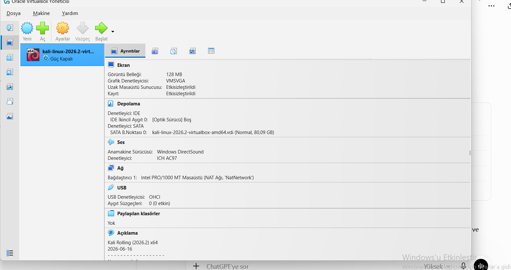
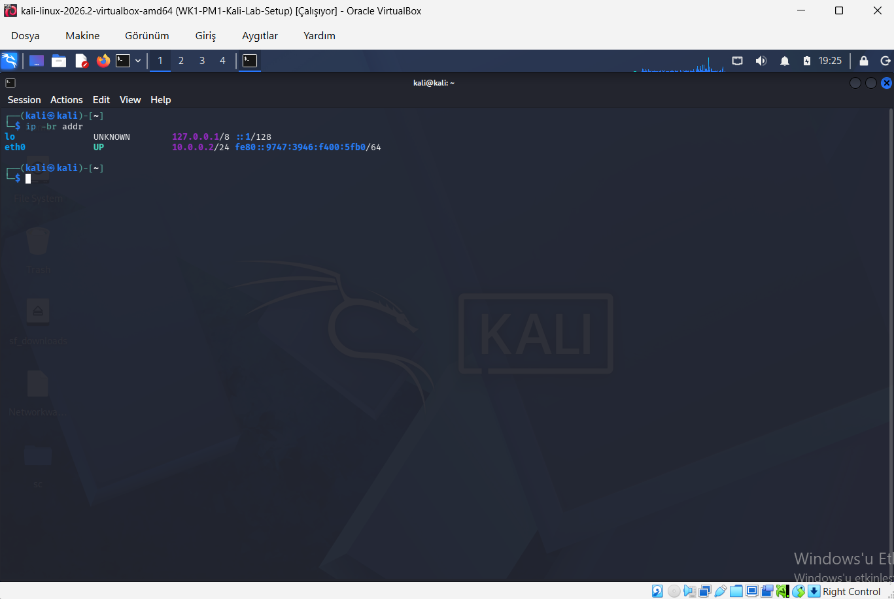
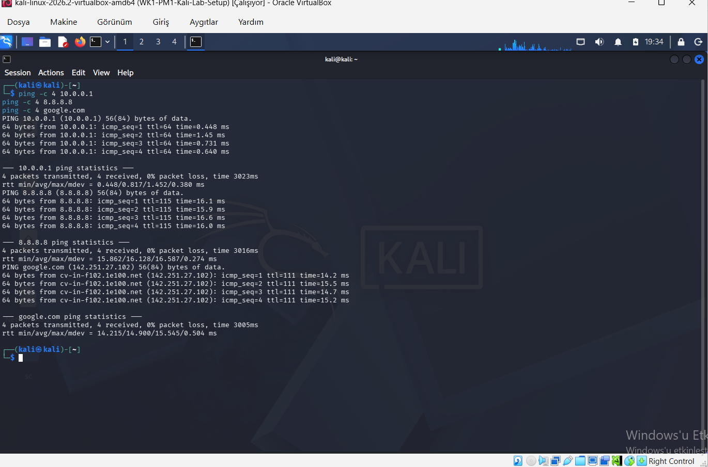
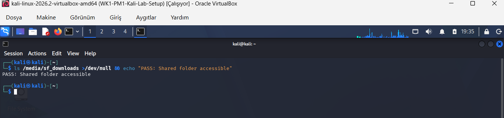
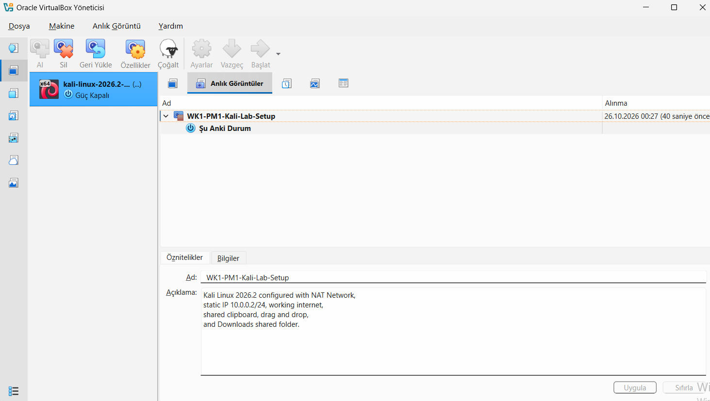

# Cybersecurity Lab Environment Setup

**Networkwalks Cybersecurity Internship | Week 1 – Project Module 1**

**Intern:** Ekrem Emir Demirhan  
**Batch:** B084  
**Project:** VirtualBox and Kali Linux Lab Setup

## 1. Project Overview

This project focuses on building a virtual cybersecurity testing environment using Oracle VirtualBox and Kali Linux.

The objective is to establish a functional, isolated virtual lab with static IPv4 addressing, internet connectivity, host–guest integration, and a recovery snapshot.

This environment will support future authorized cybersecurity and penetration testing exercises.

## 2. Tools and Technologies

- Oracle VirtualBox
- Kali Linux 2026.2 (64-bit)
- 7-Zip
- VirtualBox NAT Network
- Linux NetworkManager and `nmcli`
- IPv4 Networking and DNS

## 3. Lab Architecture

| Component | Configuration |
|---|---|
| Host OS | Windows |
| Hypervisor | Oracle VirtualBox |
| Guest OS | Kali Linux 2026.2 |
| Virtual CPUs | 2 |
| Virtual RAM | 2048 MB |
| Network Mode | NAT Network |
| Network Name | NatNetwork |
| Network Address | 10.0.0.0/24 |
| Kali Linux IP | 10.0.0.2/24 |
| Subnet Mask | 255.255.255.0 |
| Default Gateway | 10.0.0.1 |
| DNS Server | 8.8.8.8 |

## 4. Implementation Steps

### Step 1 — VirtualBox and Kali Linux Installation

1. Installed Oracle VirtualBox and 7-Zip.
2. Downloaded the official Kali Linux VirtualBox image.
3. Extracted the archive containing the `.vbox` configuration and `.vdi` virtual disk files.
4. Registered the extracted virtual machine in VirtualBox.
5. Successfully booted and logged into Kali Linux.

### Step 2 — NAT Network Configuration

1. Opened VirtualBox Network Manager.
2. Created a custom NAT Network named `NatNetwork`.
3. Configured the IPv4 network as `10.0.0.0/24`.
4. Attached Kali Linux's first network adapter to the custom NAT Network.

### Step 3 — Static IP Configuration

Configured Kali Linux with the following network settings:

- Static IPv4: `10.0.0.2/24`
- Default gateway: `10.0.0.1`
- DNS server: `8.8.8.8`

Verified the configuration using:

`ip -br addr`

`ip route`

### Step 4 — Connectivity Testing

Performed the following tests from Kali Linux:

| Test | Command | Result |
|---|---|---|
| Gateway connectivity | `ping -c 4 10.0.0.1` | Passed |
| External IP connectivity | `ping -c 4 8.8.8.8` | Passed |
| DNS resolution and connectivity | `ping -c 4 google.com` | Passed |

All three connectivity tests completed successfully.

### Step 5 — Host and Guest Integration

Configured and verified the following VirtualBox features:

- Bidirectional Shared Clipboard
- Bidirectional Drag and Drop
- Shared Windows Downloads folder
- Automatic mounting of the shared folder

Verified shared-folder access in Kali Linux using:

`ls /media/sf_downloads`

The command successfully displayed files from the Windows Downloads directory.

### Step 6 — Virtual Machine Snapshot

Created a VirtualBox snapshot after completing the lab configuration.

**Snapshot Name:** `WK1-PM1-Kali-Lab-Setup`

This snapshot provides a recovery point for future cybersecurity lab exercises.

## 5. Troubleshooting Experience

### Issue 1 — Virtual Disk Inaccessible

**Problem:** VirtualBox could not access the Kali Linux virtual disk because the original VM configuration referenced a temporary Windows directory.

**Solution:**
1. Extracted the complete Kali Linux archive into a permanent folder.
2. Removed the incorrect virtual machine registration without deleting the downloaded files.
3. Re-registered the correct `.vbox` file.
4. Verified that VirtualBox recognized the virtual disk successfully.

**Result:** Kali Linux started correctly.

### Issue 2 — Static IP Configuration Failure

**Problem:** Kali Linux failed to activate its network connection after configuring the static IPv4 address.

The error indicated that the IP configuration could not be reserved.

**Solution:** Followed the Networkwalks troubleshooting instructions and modified the NetworkManager connection settings:

`sudo nmcli connection modify "Wired connection 1" ipv4.dad-timeout 0`

Then deactivated and reactivated the network connection:

`sudo nmcli connection down "Wired connection 1"`

`sudo nmcli connection up "Wired connection 1"`

**Result:** Kali Linux successfully used `10.0.0.2/24`, and network connectivity was restored.

The address was used within the controlled virtual lab. Disabling duplicate-address-detection waiting is a troubleshooting workaround, not a replacement for ensuring that IP addresses are unique.

## 6. Project Evidence

The following screenshots document the successful implementation and verification of the cybersecurity lab environment.

### VirtualBox and Kali Linux Setup

### NAT Network Configuration

### Kali Linux Static IP Configuration

### Network Connectivity and DNS Tests

### Shared Folder Verification

### Virtual Machine Snapshot

## 7. Key Learning Outcomes

Through this project, I gained practical experience in:

- Creating and managing virtual machines
- Configuring virtual network infrastructure
- Applying static IPv4 addressing
- Understanding default gateways and DNS
- Troubleshooting Linux networking
- Configuring host–guest integration
- Creating VM recovery snapshots
- Documenting cybersecurity lab environments

## 8. Conclusion

Successfully completed the core Kali Linux cybersecurity lab setup for Networkwalks Week 1 – Project Module 1.

The environment is configured and tested, providing a foundation for future networking and authorized cybersecurity exercises.

---

**Networkwalks Cybersecurity Internship — Week 1**  
**Ekrem Emir Demirhan**
